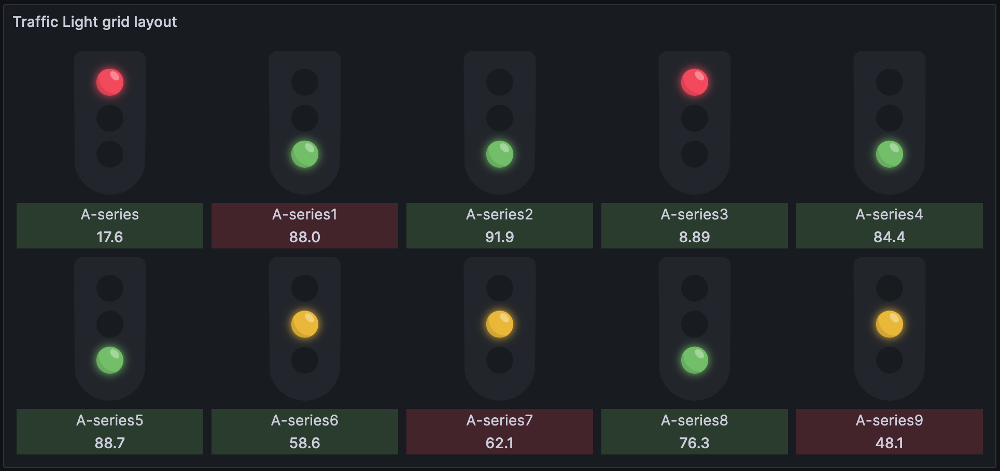
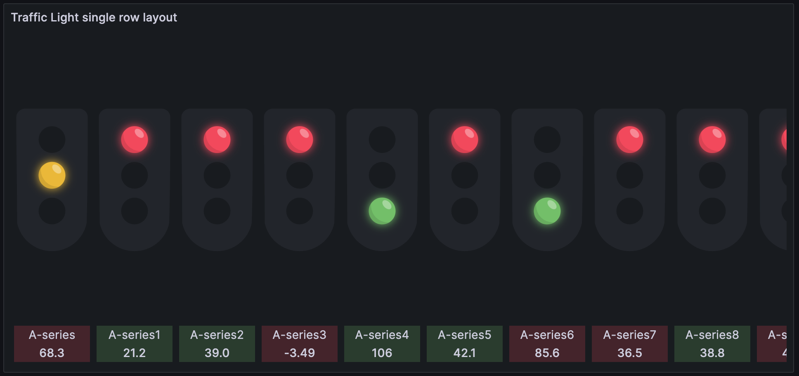
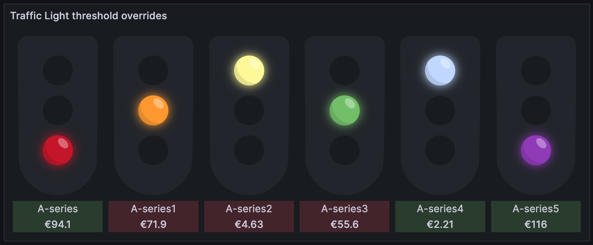

<!-- snippet:use-example-json -->

To use an example, open your dashboard and go to **Dashboard settings** > **JSON Model**. Paste the excerpt into the `panels` array and click **Save changes**.

<!-- /snippet:use-example-json -->

The examples on this page use the TestData data source, so you can try them without your own data. They come from the [example dashboard in the plugin repository](https://github.com/jackw/heywesty-trafficlight-panel/blob/main/provisioning/dashboards/panels.json), which has the full JSON for these panels and more.

## Basic example

A panel excerpt in dashboard JSON has this shape:

```json
{
  "type": "heywesty-trafficlight-panel",
  "options": {
    "style": "default",
    "sortLights": "none",
    "showValue": true,
    "showLegend": true,
    "showTrend": true
  },
  "fieldConfig": {
    "defaults": {
      "thresholds": {
        "mode": "absolute",
        "steps": [
          { "color": "red", "value": null },
          { "color": "orange", "value": 33 },
          { "color": "green", "value": 66 }
        ]
      }
    },
    "overrides": []
  },
  "targets": [
    {
      "datasource": { "type": "testdata" },
      "refId": "A",
      "scenarioId": "random_walk",
      "seriesCount": 1
    }
  ]
}
```

This panel shows one traffic light for a random walk series. The top light is red for values below `33`, the middle light is orange from `33` and the bottom light is green from `66`. The panel needs the three threshold steps to draw the lights.

## Common variations

### Grid layout

This variation shows ten series in a grid. Each light is at least 100 pixels wide, and the panel fits as many lights in each row as its width allows.

```json
{
  "type": "heywesty-trafficlight-panel",
  "options": {
    "layoutMode": "grid",
    "minLightWidth": 100,
    "style": "default",
    "sortLights": "none",
    "showValue": true,
    "showLegend": true,
    "showTrend": true
  },
  "fieldConfig": {
    "defaults": {
      "thresholds": {
        "mode": "absolute",
        "steps": [
          { "color": "red", "value": null },
          { "color": "#EAB839", "value": 40 },
          { "color": "green", "value": 70 }
        ]
      }
    },
    "overrides": []
  },
  "targets": [
    {
      "datasource": { "type": "testdata" },
      "refId": "A",
      "scenarioId": "random_walk",
      "seriesCount": 10
    }
  ]
}
```



### Single row layout

This variation shows 20 series in one row. The row scrolls horizontally when the lights don't fit.

```json
{
  "type": "heywesty-trafficlight-panel",
  "options": {
    "layoutMode": "row",
    "minLightWidth": 100,
    "style": "default",
    "sortLights": "none",
    "showValue": true,
    "showLegend": true,
    "showTrend": true
  },
  "fieldConfig": {
    "defaults": {
      "color": { "mode": "thresholds" },
      "thresholds": {
        "mode": "percentage",
        "steps": [
          { "color": "red", "value": null },
          { "color": "#EAB839", "value": 50 },
          { "color": "#73BF69", "value": 80 }
        ]
      }
    },
    "overrides": []
  },
  "targets": [
    {
      "datasource": { "type": "testdata" },
      "refId": "A",
      "scenarioId": "random_walk",
      "seriesCount": 20
    }
  ]
}
```



### Threshold overrides

This variation gives each of six series its own color scheme. Field overrides set different **Thresholds** for each series by name, and the values use the euro unit.

```json
{
  "type": "heywesty-trafficlight-panel",
  "options": {
    "layoutMode": "grid",
    "minLightWidth": 100,
    "style": "default",
    "sortLights": "none",
    "showValue": true,
    "showLegend": true,
    "showTrend": true
  },
  "fieldConfig": {
    "defaults": {
      "color": { "mode": "thresholds" },
      "thresholds": {
        "mode": "percentage",
        "steps": [
          { "color": "red", "value": null },
          { "color": "red", "value": 0 },
          { "color": "#EAB839", "value": 50 },
          { "color": "#73BF69", "value": 80 }
        ]
      },
      "unit": "currencyEUR"
    },
    "overrides": [
      {
        "matcher": { "id": "byName", "options": "A-series" },
        "properties": [
          {
            "id": "thresholds",
            "value": {
              "mode": "percentage",
              "steps": [
                { "color": "super-light-red", "value": null },
                { "color": "red", "value": 50 },
                { "color": "dark-red", "value": 80 }
              ]
            }
          }
        ]
      },
      {
        "matcher": { "id": "byName", "options": "A-series1" },
        "properties": [
          {
            "id": "thresholds",
            "value": {
              "mode": "percentage",
              "steps": [
                { "color": "super-light-orange", "value": null },
                { "color": "orange", "value": 50 },
                { "color": "dark-orange", "value": 80 }
              ]
            }
          }
        ]
      },
      {
        "matcher": { "id": "byName", "options": "A-series2" },
        "properties": [
          {
            "id": "thresholds",
            "value": {
              "mode": "percentage",
              "steps": [
                { "color": "super-light-yellow", "value": null },
                { "color": "yellow", "value": 50 },
                { "color": "dark-yellow", "value": 80 }
              ]
            }
          }
        ]
      },
      {
        "matcher": { "id": "byName", "options": "A-series3" },
        "properties": [
          {
            "id": "thresholds",
            "value": {
              "mode": "percentage",
              "steps": [
                { "color": "super-light-green", "value": null },
                { "color": "green", "value": 50 },
                { "color": "dark-green", "value": 80 }
              ]
            }
          }
        ]
      },
      {
        "matcher": { "id": "byName", "options": "A-series4" },
        "properties": [
          {
            "id": "thresholds",
            "value": {
              "mode": "percentage",
              "steps": [
                { "color": "super-light-blue", "value": null },
                { "color": "blue", "value": 50 },
                { "color": "dark-blue", "value": 80 }
              ]
            }
          }
        ]
      },
      {
        "matcher": { "id": "byName", "options": "A-series5" },
        "properties": [
          {
            "id": "thresholds",
            "value": {
              "mode": "percentage",
              "steps": [
                { "color": "super-light-purple", "value": null },
                { "color": "purple", "value": 50 },
                { "color": "dark-purple", "value": 80 }
              ]
            }
          }
        ]
      }
    ]
  },
  "targets": [
    {
      "datasource": { "type": "testdata" },
      "refId": "A",
      "scenarioId": "random_walk",
      "seriesCount": 6
    }
  ]
}
```



### Table data

This variation reads a table instead of time series. The panel draws one light for each row and uses the `Name` column as the legend. Table data has no trend.

```json
{
  "type": "heywesty-trafficlight-panel",
  "options": {
    "layoutMode": "row",
    "minLightWidth": 100,
    "style": "default",
    "sortLights": "none",
    "showValue": true,
    "showLegend": true
  },
  "fieldConfig": {
    "defaults": {
      "color": { "mode": "thresholds" },
      "thresholds": {
        "mode": "absolute",
        "steps": [
          { "color": "red", "value": null },
          { "color": "#EAB839", "value": 2 },
          { "color": "#73BF69", "value": 4 }
        ]
      }
    },
    "overrides": []
  },
  "targets": [
    {
      "datasource": { "type": "testdata" },
      "refId": "A",
      "scenarioId": "csv_content",
      "csvContent": "\"Name\",\"Value\"\n\"Blob Storage\", 1\n\"Exported Storage\", 4\n\"Hangfire\", 3\n\"Imported Storage\", 5\n\"SQL server db\", 1"
    }
  ]
}
```
