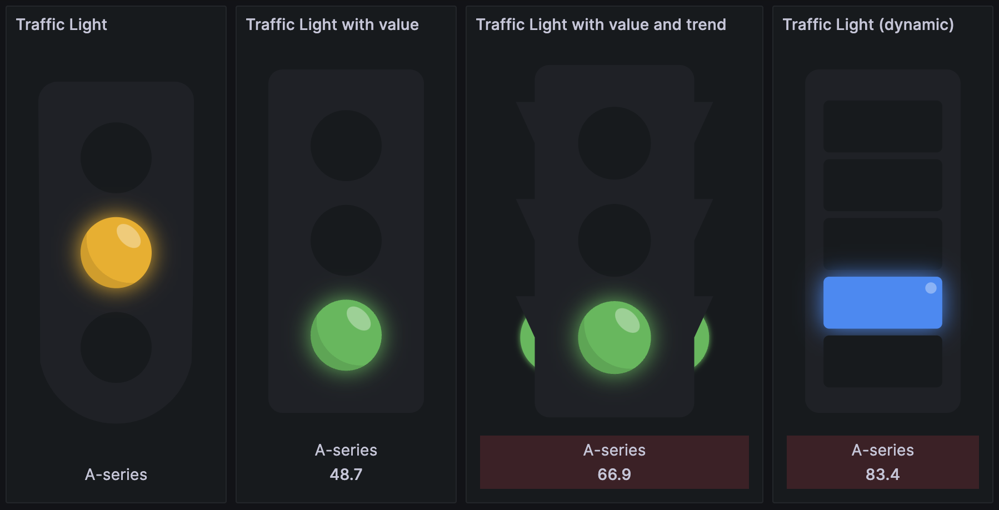
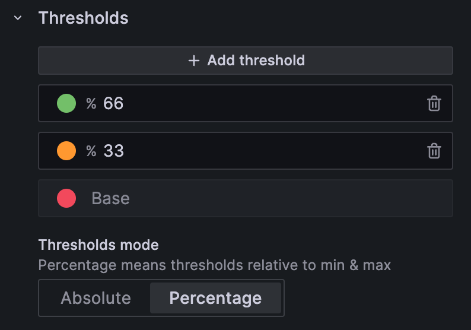

To change these options, edit the panel and use the options pane. The panel adds its own options in the **Traffic Light** section and uses the standard field options, including thresholds, to color the lights.

## Panel options

| Option                    | Type         | Default                                                         | Description                                       |
| ------------------------- | ------------ | --------------------------------------------------------------- | ------------------------------------------------- |
| Minimum light width       | Number       | `100`                                                           | Set the minimum traffic light width               |
| Layout                    | Radio        | `Grid`                                                          | Layout traffic lights in a grid, row, or marquee. |
| Reverse light colors      | Toggle       | Off                                                             | Reverse the order of the light colors             |
| Sort lights               | Radio        | No option selected. The panel sorts lights in descending order. | Sort lights based on values                       |
| Show value                | Toggle       | On                                                              | Show or hide the value                            |
| Show legend               | Toggle       | On                                                              | Show or hide the legend (query name)              |
| Show trend                | Toggle       | On                                                              | Show or hide the trend color                      |
| Traffic light style       | Select       | `Default`                                                       | Choose the style for the traffic lights           |
| Horizontal traffic lights | Toggle       | Off                                                             | Change the orientation of the traffic lights      |
| Custom colors             | Toggle       | Off                                                             | Enable custom background and empty light colors.  |
| Dark theme background     | Color picker | `#2d3640`                                                       | Traffic light background color for dark theme     |
| Dark theme empty lights   | Color picker | `#1e2229`                                                       | Empty light color for dark theme                  |
| Light theme background    | Color picker | `#C5C5C8`                                                       | Traffic light background color for light theme    |
| Light theme empty lights  | Color picker | `#AAAAAF`                                                       | Empty light color for light theme                 |

The four color pickers appear only when **Custom colors** is on. Each one applies to the matching Grafana theme.

### Layout

- **Grid** places the lights in a grid. The panel fits as many lights in each row as the panel width allows, with each light at least **Minimum light width** wide.
- **Row** places all lights in one row. If the lights don't fit, the row scrolls horizontally.

### Sort lights

- **None** keeps the order of the series or table rows.
- **Ascending** orders lights from the lowest value to the highest.
- **Descending** orders lights from the highest value to the lowest.

### Traffic light style

- **Default**, **Rounded** and **Sidelights** draw a traffic light with three lights.
- **Dynamic** draws one light for each threshold step, so you can use more than three lights.

### Value, legend and trend

Below each light, the panel shows the legend and the value. **Show legend** shows the display name of the series, or the string value of the table row. **Show trend** colors the background of this area green when the values go up and red when they go down. Table data has no trend. For how the panel computes the trend, refer to [Field mapping](./data-formats.md#field-mapping).

## Standard field options

For what each standard option does, refer to [Configure standard options](https://grafana.com/docs/grafana/latest/panels-visualizations/configure-standard-options/).

All standard options are enabled:

- Unit
- Min
- Max
- Decimals
- Display name
- Color scheme
- No value
- Value mappings
- Thresholds
- Data links

If you add data links, click a light to open a menu with the links. For more information, refer to [Configure data links](https://grafana.com/docs/grafana/latest/panels-visualizations/configure-data-links/).

## Configure thresholds

The panel uses thresholds to decide which light turns on. Each threshold step is one light, and its color is the color of that light.

To set up the thresholds:

1. In the panel editor, find the **Thresholds** section.
1. Make sure there are at least three steps, including **Base**. Click **Add threshold** to add a step.
1. Set a color for each step.

If there are fewer than three steps, the **Default**, **Rounded** and **Sidelights** styles show an **Invalid thresholds** message instead of the lights. The **Dynamic** style shows nothing.

The panel compares the value with the step values directly, so **Percentage** mode works the same way as **Absolute** mode.

### How steps map to lights

- **Default**, **Rounded** and **Sidelights** use the first three steps. **Base** is the top light, the second step is the middle light and the third step is the bottom light. If the value falls in a fourth or later step, none of the lights turns on.
- **Dynamic** draws one light for each step, with **Base** at the top.

Grafana sorts threshold steps from lowest to highest. If the highest step means "stop" and the base step means "go", turn on **Reverse light colors** to reverse the order of the lights.

> [!TIP]
> To give some lights a different color scheme, add a field override that sets **Thresholds** for those fields. With the **Dynamic** style, overrides can also give each light a different number of steps. For an example, refer to [Threshold overrides](./examples.md#threshold-overrides).
